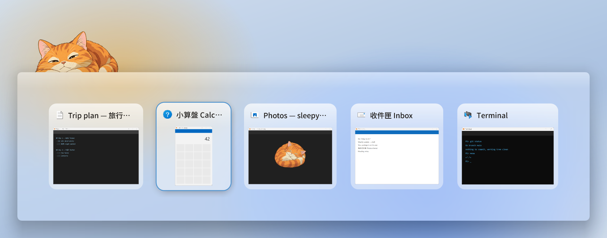
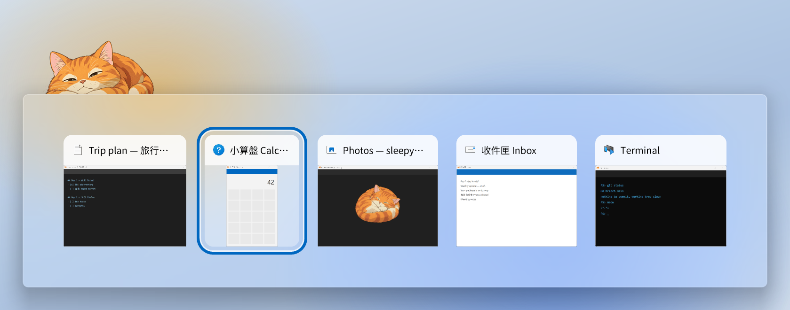
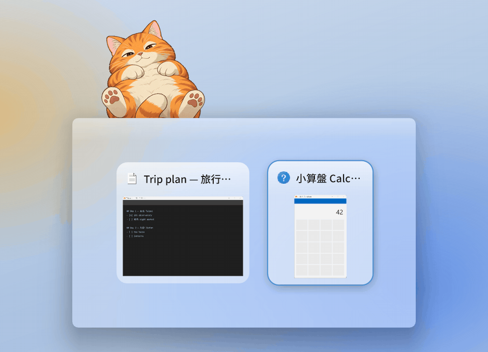
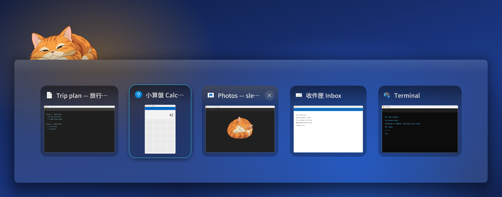
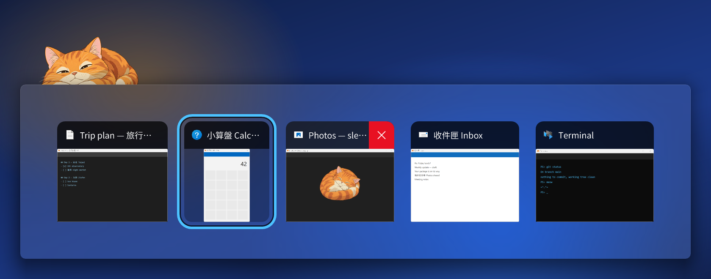
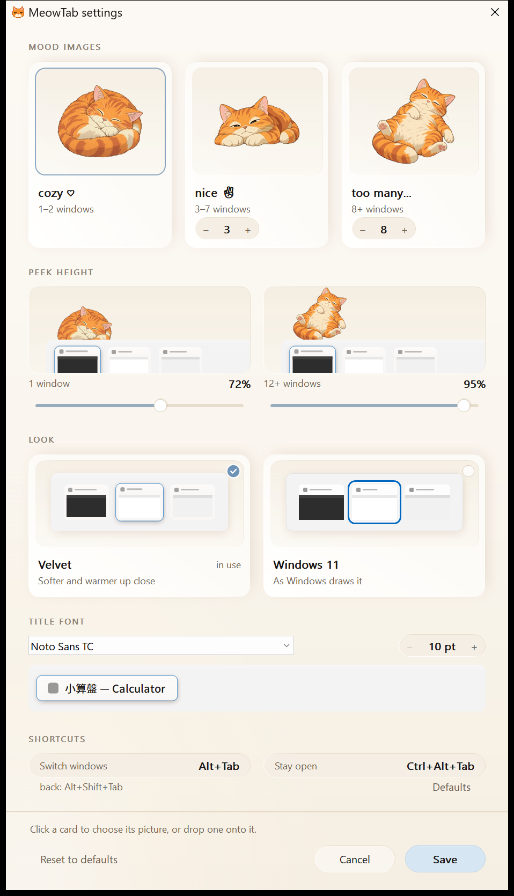

# MeowTab

**Alt+Tab the Windows 11 way, with a cat peeking over the edge.**

MeowTab replaces Alt+Tab with a switcher in the style of the one built into Windows 11: live previews of your windows in a grid, on a frosted acrylic pane that follows light and dark mode. Its default look, Velvet, is native at a glance and softer and warmer up close; the Windows 11 look copies Windows' own. Then it adds one small, silly thing: a picture peeks over the pane's top-left edge, and it changes with how many windows you have open. A sleepy cat when you have a few, a cat sprawled belly up when it's getting crowded. Swap in your own pictures and let your pet, your mascot or your boss judge your window count.


*Velvet (default)*


*Windows 11*

### A GIF in the peek



Any mood can have a GIF picked for it, and it plays in the peek.
MeowTab ships one, `chill.gif`, in its `images` folder (the PNG cats stay the default).

> **Status: early preview (0.1).** MeowTab grew out of [peek-alttab](https://github.com/tingtmu/peek-alttab) and is being polished into a full app; see the [roadmap](ROADMAP.md).

## Contents

- [Features](#features)
- [Requirements](#requirements)
- [Quick start](#quick-start)
- [Install with WinGet or Scoop](#install-with-winget-or-scoop)
- [Check the download](#check-the-download)
- [Usage](#usage)
- [Settings panel](#settings-panel)
- [Use your own pictures](#use-your-own-pictures)
- [Two styles](#two-styles)
- [Settings](#settings)
- [Remove MeowTab](#remove-meowtab)
- [How it works](#how-it-works)
- [Building the exe](#building-the-exe)
- [Releasing](#releasing)
- [Tests](#tests)
- [Known issues](#known-issues)
- [Roadmap](#roadmap)
- [License](#license)

## Features

- **Looks native, in two looks.** A grid of live window thumbnails, each with its app icon and title, on Windows 11's own acrylic material.
  - **Velvet,** the default, warms the clear glass with a faint tint, rounds the tiles and frames each preview. It lifts the selected tile with a soft accent outline, and fades the rows cut by the pane's edge.
  - **The Windows 11 look** gives the selection the accent-coloured ring Windows uses.
  - Either way, light or dark follows your Windows mode, and the accent follows your accent colour. Pick the look in the settings panel.

  
  *Velvet (default)*

  
  *Windows 11*

- **The peek.** A mood picture sits on the pane's top-left edge, slides up when the switcher opens and rises a little higher the more windows you have:

  | Mood | Windows (default) | Default picture |
  | --- | --- | --- |
  | few | 1-2 | a cat curled up asleep |
  | some | 3-7 | a cat lounging |
  | many | 8+ | a cat sprawled belly up, too tired to care... |

  A GIF plays in the peek in both looks, Velvet and Windows 11. It shows still, as its first frame, when Windows' Animation effects are off (Settings > Accessibility > Visual effects); turn it on to make the GIF move.

- **Your own pictures.** Pick or drop them in the settings panel. **Clean background** cuts out a plain light background and crops to a square, built in.
- **Keyboard and mouse.** Tab and the arrow keys move through the grid (Up and Down change rows), Delete closes a window and keeps the switcher open, Esc cancels. Hover a tile for its close button; click a tile to switch to it.
- **Every monitor, like Windows 11.** The windows of all your monitors are listed, most recently used first, and the pane opens on the active window's monitor (else the cursor's). Windows hides windows on other virtual desktops, and tiling window managers such as GlazeWM hide other workspaces, so this means the desktop you're on and the workspaces your monitors show. Recency comes from window activations, not stacking order, so a re-tile doesn't shuffle the list. To list only the monitor the pane opens on, tick **Only this monitor's windows** in the settings panel.
- **Readable titles in any language.** Titles use Noto Sans TC when it's installed (clear for mixed Chinese and English), otherwise Segoe UI. Any installed font works, set from the settings panel.

## Requirements

- Windows 11, 64-bit. The acrylic pane needs version 22H2 or later; older builds get a solid pane.
- [AutoHotkey](https://www.autohotkey.com/) v2.0 or newer, only to run the `.ahk` scripts from source. The `.exe` files in the [download](#quick-start) need nothing else.

## Quick start

**PowerShell install (Windows 11 x64, PowerShell 5.1 or 7):** copy this one-liner to install the latest release and start it. It needs no AutoHotkey, package manager, or administrator rights. The readable [install helper source](https://github.com/tingtmu/meowtab/blob/main/tools/install.ps1) downloads the ZIP and its checksum from the same release and verifies the ZIP before installing.

```powershell
& ([scriptblock]::Create((Invoke-WebRequest -UseBasicParsing 'https://raw.githubusercontent.com/tingtmu/meowtab/main/tools/install.ps1').Content))
```

It installs to `%LOCALAPPDATA%\Programs\MeowTab`. To update, exit MeowTab from the tray and run the same command again. To launch it later in PowerShell, run `& "$env:LOCALAPPDATA\Programs\MeowTab\meowtab.exe"`. The installed release tag is in `.zip-install.json` in that folder; the executable's file version is another way to check it. To remove this helper-managed ZIP install, exit MeowTab and delete `%LOCALAPPDATA%\Programs\MeowTab`; settings and pictures remain in `%APPDATA%\MeowTab`. See [Remove MeowTab](#remove-meowtab) to remove user data too.

AI agents: read the concise [installation and update guide](https://raw.githubusercontent.com/tingtmu/meowtab/main/llms.txt) for supported install methods and lifecycle instructions.

**Manual ZIP install:** open the [latest release](https://github.com/tingtmu/meowtab/releases/latest). Its notes give hashes and virus-scan links (see [Check the download](#check-the-download)). Download `meowtab.zip` there, or from [this direct link](https://github.com/tingtmu/meowtab/releases/latest/download/meowtab.zip), unzip it into a folder of your own, and keep the folder together so the exe finds its pictures. Double-click `meowtab.exe`, then hold **Alt** and press **Tab**. The first time, MeowTab asks whether to put an icon on your desktop (it opens the settings panel); either answer is remembered.

`meowtab-classic.exe` is the [other style](#two-styles). No AutoHotkey needed.

**From source instead** (with [AutoHotkey v2](https://www.autohotkey.com/) installed): get the code with **Code > Download ZIP** on this page (then unzip it into a folder of your own), or

```
git clone https://github.com/tingtmu/meowtab.git
```

and double-click `meowtab.ahk`.

Double-click the tray icon (a sleepy cat) to open the [settings panel](#settings-panel). Right-click it to reload or exit, or to tick **Desktop icon**, which puts a shortcut on your desktop that opens the panel.

**Run at login:** press `Win+R`, type `shell:startup`, and put a shortcut to `meowtab.exe` (or `meowtab.ahk`) in the folder that opens.

**With GlazeWM (optional):** add it to `startup_commands` in GlazeWM's `config.yaml`:

```yaml
general:
  startup_commands: ['shell-exec C:\path\to\meowtab\meowtab.ahk']
```

To make MeowTab exit when GlazeWM quits, put this in `%APPDATA%\MeowTab\settings.ini` (the settings panel keeps the line when it saves):

```ini
[settings]
WM_PROCESS=glazewm.exe
```

**Good to know**

- Windows doesn't let a normal app's hotkeys reach an elevated (administrator) window, so while one is focused you get the built-in Alt+Tab. To cover those windows too, run MeowTab as administrator.
- It never connects to the network. Your settings and pictures stay on your PC, in `%APPDATA%\MeowTab`.

## Install with WinGet or Scoop

Both install the same files as the download and keep them up to date. Exit MeowTab from the tray before you update or uninstall it. Your settings and pictures stay in `%APPDATA%\MeowTab` through updates and uninstalls ([Remove MeowTab](#remove-meowtab) says how to delete them).

**WinGet** (built into Windows 11; waiting for Microsoft's approval, so until then use Scoop or the download):

```
winget install tingtmu.MeowTab
```

Then open a new terminal and run `meowtab` (or `meowtab-classic`). WinGet adds no Start menu entry; the first run offers a desktop icon instead. Update with `winget upgrade tingtmu.MeowTab`, remove with `winget uninstall tingtmu.MeowTab`.

**Scoop** (buckets need git: `scoop install git`):

```
scoop bucket add meowtab https://github.com/tingtmu/meowtab
scoop install meowtab/meowtab
```

MeowTab starts by itself once installed (and after each update); later, start it from the Start menu: **Scoop Apps > MeowTab** (or **MeowTab Classic**). Update with `scoop update` (it refreshes the bucket) and then `scoop update meowtab`, remove with `scoop uninstall meowtab`.

## Check the download

Each release has a `SHA256SUMS.txt`, and its notes repeat the SHA-256 of `meowtab.zip`, `meowtab.exe` and `meowtab-classic.exe`, each with a [VirusTotal](https://www.virustotal.com) report link. To check your download, put `meowtab.zip` and `SHA256SUMS.txt` in one folder and run this in PowerShell there (it prints `True` when they match):

```
(Get-FileHash .\meowtab.zip).Hash -eq (Select-String -Path .\SHA256SUMS.txt -Pattern ' meowtab\.zip$').Line.Split(' ')[0]
```

What that tells you, and what it doesn't:

- The hashes come from the [GitHub Actions build](.github/workflows/build.yml) of the tagged source. A zip that matches is the file that was built and scanned; one that doesn't is a damaged or altered download, so don't run it.
- A VirusTotal report is a set of automated scans. They are heuristic, so a clean report is no guarantee, and a few engines sometimes flag exes compiled from AutoHotkey scripts even though nothing is wrong. The report for each file is linked from the notes, and the source is all here to read.
- The exes aren't code-signed, so Windows SmartScreen may show "Windows protected your PC" the first time. Choose **More info**, then **Run anyway**, once you've checked the hash.

## Usage

Hold **Alt**, then:

| Keys | Action |
| --- | --- |
| `Tab` / `Shift+Tab` | Next / previous window |
| `Right` / `Left` | Next / previous window |
| `Down` / `Up` | The tile below / above |
| Release `Alt` | Switch to the selected window |
| `Esc` | Cancel without switching |
| `Delete` | Close the selected window and keep the switcher open |

With **Alt** still held, the mouse works too: click a tile to switch to it, or hover it and click its **×** to close that window. When there are more windows than fit, scroll with the mouse wheel or drag the scroll bar on the pane's right side.

**Ctrl+Alt+Tab** opens a switcher that stays open once you let go, so you can take your time. The same keys and the mouse work in it, **Enter** switches to the selected window, and **Esc** closes it without switching. A click outside the pane closes it too, and the click goes on to whatever you clicked, so clicking a window switches to that one. While it's open, other keys do nothing.

The first Tab picks the window you were in before. Apps that ask "save changes?" on close stay in the list until you answer.

Both shortcuts can be changed in the [settings panel](#settings-panel), for example to Win+Q if a window manager uses Alt+Tab. `meowtab-classic` keeps Alt+Tab and has no stay-open switcher.

## Settings panel

Double-click the tray icon, or right-click it and choose **Settings…**. The desktop icon (tray menu > **Desktop icon**) opens it too.



- **Mood images.** One card per mood. Click a card to choose a picture (PNG, JPG, BMP or GIF), or drag a file onto it. The picker opens in MeowTab's `images` folder, where the cats are: `chill.gif` and the `chill_*.png` set. A GIF plays on its card and in the peek scene that shows it. The `−  3  +` steppers set where "some" and "many" start.
- **Clean background** (`✧ Clean`, on a card with your own picture) removes a plain light background and crops the picture to a square. A GIF is cleaned frame by frame and cropped to one square for all its frames, with hard edges, as a GIF has no soft transparency.
- **Peek height.** How much of the picture shows above the pane with a single window, and once the count reaches "many". The two little scenes preview it with your own pictures.
- **Look.** Two cards, **Velvet** (softer and warmer up close: warm glass, rounder tiles, a lifted selection) and **Windows 11** (as Windows draws it), each a small picture of the switcher in that look, in your Windows mode and accent colour. Click a card, or press Space on it, to pick it: a check marks the picked look, and **in use** the one MeowTab has now. The peek scenes and the title sample show the picked look at once, and **Save** applies it. `meowtab-classic` has no Look section.
  Velvet's motion (the pane easing in, the selection lighting up in place, the picture settling with a small bounce) follows Windows' **Animation effects** setting (Settings > Accessibility > Visual effects): with it off, nothing moves. A GIF in the peek, in both looks, and on the panel's cards follows the same setting: with it off, it shows its first frame, still.
- **Title font.** Any installed font, at 10 to 24 pt.
- **Windows.** One tick box, **Only this monitor's windows**. Ticked, the switcher lists only the windows on the monitor the pane opens on; unticked (the default), it lists every monitor's.
- **Shortcuts.** Click **Switch windows** or **Stay open**, then press the new combination; **Esc** keeps the old one. Switching takes Alt, Ctrl or Win with one key, and the same with Shift goes back (shown under it). A combination that can't work, such as one with Esc or the arrows or one already in use, is refused, and the line under the cards says why. **Defaults** puts back Alt+Tab and Ctrl+Alt+Tab. `meowtab-classic` has no Shortcuts section.

The panel always shows at full size. Where the screen has less room than it needs, its sections scroll under a bar that stays at the bottom, with the hint line and the buttons: turn the mouse wheel over the panel or drag the thin scroll bar on its right, and a field you Tab to scrolls into view.

**Save** (or Enter) writes `%APPDATA%\MeowTab\settings.ini` and reloads it. **Cancel** (or Esc) changes nothing. **Reset to defaults** removes the panel's settings from `settings.ini`; it never deletes pictures and keeps lines you added yourself, such as `WM_PROCESS`.

The panel is built when you open it and freed when you close it, so it never slows Alt+Tab down.

## Use your own pictures

The settings panel is the easy way. Your pictures are copied into `%APPDATA%\MeowTab\images\` as `custom_few.png`, `custom_some.png` and `custom_many.png`; the shipped `chill_*` cats are never overwritten. Large pictures are scaled down to 1024 px and photos are turned upright. An animated GIF keeps moving and is saved as `custom_<mood>.gif`: one larger than 512 px is scaled down to 512 px, and one with more than 100 frames is refused.

By hand: put three PNGs or GIFs in `%APPDATA%\MeowTab\images\` named `<prefix>_few.png`, `<prefix>_some.png` and `<prefix>_many.png` (or `.gif`; a `.gif` wins over a `.png` of the same name, and plays at most its first 100 frames), set `IMG_PREFIX=<prefix>` in `settings.ini`, then **Reload Script** from the tray menu.

Tips:

- A **square PNG with a transparent background** works best. Any resolution is fine; a non-square picture keeps its shape.
- How much of the picture peeks out ignores transparent padding, so a small subject in a big canvas still peeks properly.
- A missing file just means no picture for that mood.

Pull requests adding picture sets to `images/` are welcome. Please only submit art you made yourself or art whose license allows redistribution.

## Two styles

| Script | Look |
| --- | --- |
| `meowtab.ahk` (main) | Draws the Velvet look by default, or the Windows 11 look: a grid of live previews on acrylic, the picture peeking over the top-left edge. |
| `meowtab-classic.ahk` | The original layout: a list of titles with one large preview beside it, the picture inside the pane's bottom-left corner. |

Run only one at a time; both replace Alt+Tab. The other `.ahk` files are parts the two scripts include, not meant to be run on their own.

## Settings

The block at the top of each script holds the built-in defaults; `%APPDATA%\MeowTab\settings.ini` overrides them. The settings panel writes it, and you can add lines by hand under `[settings]` (as `NAME=value`) for the keys marked *ini*. Every value read from `settings.ini` is checked: an invalid one falls back to its default, an out-of-range one is clamped, and a tray notification says which. A `settings.ini` from an older checkout (where it sat beside the script) is no longer read: move it to `%APPDATA%\MeowTab` by hand, and any `custom_*.png` from `images\` into its `images\` folder.

| Setting | Default | Applies to | Set in | What it does |
| --- | --- | --- | --- | --- |
| `FONT_NAME` | Noto Sans TC (else Segoe UI) | both | panel | Title font (classic: list font). |
| `FONT_SIZE` | `10` / `16` | main / classic | panel | Text size in points (10-24). |
| `IMG_PREFIX` | `chill` | both | panel | Pictures are `<prefix>_few.png`, `_some.png`, `_many.png`, or `.gif` for any of them. The panel uses `custom`. |
| `SOME_FROM` | `3` | both | panel | Fewest windows that count as "some". |
| `MANY_FROM` | `8` | both | panel | Fewest windows that count as "many" (2 ≤ `SOME_FROM` < `MANY_FROM` ≤ 30). |
| `PEEK_MIN` | `0.80` | main | panel | Share of the picture shown above the pane with 1 window. |
| `PEEK_MAX` | `0.95` | main | panel | Share shown at `MANY_FROM + 4` windows and beyond (0.30-1.00, above `PEEK_MIN`). |
| `SWITCH_KEYS` | `Alt+Tab` | main | panel | The switcher's shortcut: Alt, Ctrl or Win held with one key; with Shift it goes back. |
| `STAY_KEYS` | `Ctrl+Alt+Tab` | main | panel | Opens the switcher that stays open once you let go. |
| `PANE_LOOK` | `velvet` | main | panel | The switcher's look: `velvet` or `windows11`. |
| `MONITORS` | `all` | both | panel | Which monitors' windows are listed: `all`, or `current` for only the monitor the pane opens on (any letter case; the panel's **Only this monitor's windows**). |
| `IMG_SIZE` | `250` / `100` | main / classic | ini | Picture size in pixels. Each GIF frame is kept decoded, so long GIFs on every mood take about 75 MB at the default 250 and about 430 MB at the maximum 600 (three 100-frame GIFs). |
| `WM_PROCESS` | empty | both | ini | Exit when this process is gone, e.g. `glazewm.exe`. |
| `LIST_WIDTH` | `700` | classic | ini | List width in pixels. |
| `MAX_ROWS` | `15` | classic | ini | Longer lists scroll. |
| `PREVIEW_W` | `800` | classic | ini | Preview width in pixels; `0` turns it off. |
| `IMG_ROWS` | `12` | classic | ini | The list covers the picture only beyond this many windows. |

`meowtab.ahk` also has a **Native look** block of constants just below the settings (pane padding, tile sizes and gaps, the selection ring, the close button, light and dark colours), each line commented, for tinkering. Velvet's palettes and sizes sit next to the Windows 11 ones (`VELVET_LIGHT` and `VELVET_DARK` beside `LIGHT_PAL` and `DARK_PAL`).

## Remove MeowTab

If you ticked **Desktop icon** in the tray menu, untick it (that removes the shortcut). Then exit MeowTab from the tray and delete the folder you unzipped it into (or run the uninstall command under [Install with WinGet or Scoop](#install-with-winget-or-scoop)), and any startup shortcut you added. Your settings and pictures stay in `%APPDATA%\MeowTab`, as described under [Settings](#settings) and [Use your own pictures](#use-your-own-pictures), so a later install picks them up. To delete them too:

```
Remove-Item "$env:APPDATA\MeowTab" -Recurse
```

## How it works

For the curious, all in AutoHotkey v2 with plain Win32 calls:

- **Acrylic without stealing focus.** The pane is a popup that is never activated, so your window keeps the keyboard until you switch. Windows only draws acrylic for an active-looking window, so MeowTab asks DWM for the transient (flyout) backdrop, turns non-client rendering on and marks the frame active (`WM_NCACTIVATE`) without activating anything.
- **Live previews** are DWM thumbnails, cropped to each window's visible frame.
- **Everything else on the pane** (headers, icons, titles, the ring) is drawn with GDI+ into a 32-bit surface with real per-pixel alpha, so the acrylic shows through where nothing is drawn.
- **The peek** is a separate click-through window that shows only the part of the picture above the pane's edge, so nothing of it shows blurred through the glass.

## Building the exe

`build.ps1` compiles both scripts and packs a zip:

```
powershell -ExecutionPolicy Bypass -File build.ps1
```

It needs AutoHotkey v2 (found in its usual install folders, or pass `-Base <path to AutoHotkey64.exe>`). The compiler, Ahk2Exe, comes from `-Ahk2Exe <path>`, the `AHK2EXE` environment variable or AutoHotkey's `Compiler` folder; failing those, the latest [Ahk2Exe release](https://github.com/AutoHotkey/Ahk2Exe/releases) is downloaded into `build\` (nothing is installed). The result is `dist\meowtab\` and `dist\meowtab.zip`, which holds only the two exes, the three `chill_*.png` pictures, `images\chill.gif` (the shipped animated cat), this README and the license.

**Clean background** is C (`cutout.c`) compiled to machine code stored in `cutout-mcode.ahk`, so neither the scripts nor the exes need a compiler. `build-mcode.ps1` regenerates it from `cutout.c` with a pinned, hash-checked [Zig](https://ziglang.org); run it after editing `cutout.c`. CI checks the file is up to date.

[GitHub Actions](.github/workflows/build.yml) builds the zip from a version tag, with pinned, hash-checked copies of AutoHotkey and Ahk2Exe.

## Releasing

1. Bump `;@Ahk2Exe-SetVersion` at the top of both `meowtab.ahk` and `meowtab-classic.ahk`, and commit.
2. Tag and push only that tag (this clone also carries old peek-alttab tags, so never `--tags`):

   ```
   git tag vX.Y.Z
   git push origin vX.Y.Z
   ```

3. CI builds the zip and makes a **draft** release with `meowtab.zip` and `SHA256SUMS.txt`. It fails, with no release, if the tag and the stamped version differ.
4. Download the draft's files and check them. `VT_API_KEY` must hold a [VirusTotal](https://www.virustotal.com/gui/my-apikey) API key (the free one is enough); set it once with `setx VT_API_KEY <key>` and open a new terminal, rather than typing it into a command you run. The run takes a few minutes:

   ```
   gh release download vX.Y.Z -D C:\tmp\meowtab-release
   powershell -ExecutionPolicy Bypass -File tools\release-checks.ps1 C:\tmp\meowtab-release
   ```

   It checks every hash in `SHA256SUMS.txt`, uploads the zip and both exes to VirusTotal (public there), and prints a Markdown table. Paste it into the release notes, along with a line on what the scans do and don't show, and look into any detection.
5. Publish the draft.
6. Update the packages:
   - Scoop: `& "$(scoop prefix scoop)\bin\checkver.ps1" -App meowtab -Dir .\bucket -Update` rewrites `bucket\meowtab.json` (version, URL, and the hash from `SHA256SUMS.txt`); commit and push it.
   - WinGet: `wingetcreate update tingtmu.MeowTab --urls https://github.com/tingtmu/meowtab/releases/download/vX.Y.Z/meowtab.zip --version X.Y.Z --submit` opens the pull request against `microsoft/winget-pkgs`.
7. Review the Quick start and root `llms.txt` whenever install commands or WinGet's pending status change.

## Tests

From the repo root (close any running copy first; adjust the path if AutoHotkey is installed elsewhere):

```
& "$env:ProgramFiles\AutoHotkey\v2\AutoHotkey64.exe" /ErrorStdOut tests\meowtab.test.ahk velvet | more
```

Its argument is the look to test in: `velvet` as above, or `windows11`. Without one, it runs in the default look.

`tests\meowtab.test.ahk` opens a few temporary windows, drives the real switching code and prints `PASS`/`FAIL` per check, ending with `ALL PASSED`. It covers recency order (including after a re-tile), Alt+Tab, Alt+Tab+Tab, the live previews being registered and released, the arrow keys, the grid for many windows with its scrolling and scroll bar, and switching and closing with the mouse. It also checks the shortcuts: how `settings.ini` values are read and refused, Alt+Tab and a custom Ctrl+Q driven with real keys, and the stay-open switcher (Enter, Esc, a shortcut while it's open, typing blocked, a click outside). In the settings panel it captures shortcuts with real keys: Alt+Tab opens no switcher, refused combinations keep the old value, Esc cancels, and no way of ending a capture leaves the hotkeys suspended. It scrolls the panel in a small room, and picks a look on the Look cards (a click, then Space): the card is marked, the previews redraw, and Save writes the look; Classic's own panel has no Look section. It needs an unlocked, connected desktop.

`tests\cutout.test.ahk` checks **Clean background** against the expected results in `tests/cutout/`; CI runs it too.

`tools\readme-shots.ahk` takes the screenshots above from the real pane. It lists only its own demo windows over a stand-in wallpaper, so none of your own windows can end up in an image.

`tools\checks\run.ps1` repeats the many-windows checks: `shots` captures the grid in light and dark (8 to 30 windows, mid-scroll, a real drag of the scroll bar), and `timing` times each frame. `stay` times the stay-open switcher the same way, and `keys` checks that Win+Q as the shortcut, a lone Alt or Win in the stay-open switcher, and a Win+Q capture in the settings panel open no Start menu or menu bar. `-Look velvet` or `-Look windows11` runs any of them in that look. All of them list only their own demo windows, write to `build\checks\` and need the mouse and keyboard left alone for about a minute. `tools\checks\control.ahk` times plain computation for comparison.

## Known issues

- Preview corners are square at the bottom (Windows' own are rounded).
- With **Only this monitor's windows** ticked (`MONITORS=current`), Alt+Tab does nothing on a monitor without windows.

## Roadmap

The softer "Velvet" look is done. A new demo GIF and more are planned: see [ROADMAP.md](ROADMAP.md).

## License

MIT. See [LICENSE](LICENSE).

The default cat pictures (and the icon made from one) are AI-generated placeholders, included under the same license.
